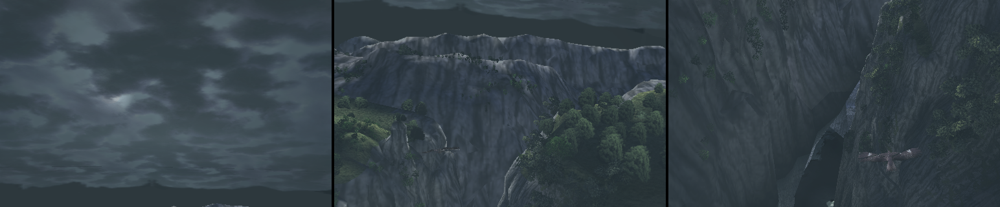
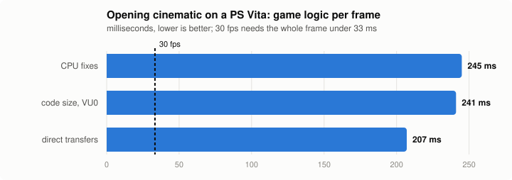

# Celosia Vita

**Shadow of the Colossus (PS2, USA, SCUS-97472) running natively on the PS Vita.**

The game's MIPS code is statically recompiled to C++ and compiled for the
Vita's ARM CPU; a native OpenGL ES renderer draws its models directly. No
emulator runs the game. This repository is a Vita-first fork of
[HenryKun55/celosia](https://github.com/HenryKun55/celosia): every change here
is measured on a real Vita, not in Vita3K.


<sub>The opening cinematic, captured on a PS Vita with this build.</sub>

> **No game data is included.** You need your own copy of the game.

## Contents

- [Status](#status)
- [Why it is slow, and the plan](#why-it-is-slow-and-the-plan)
- [What this fork changed](#what-this-fork-changed)
- [Building](#building)
- [Installing on the Vita](#installing-on-the-vita)
- [A real Vita as a dev console](#a-real-vita-as-a-dev-console)
- [Measuring](#measuring)
- [Layout](#layout)
- [Credits and license](#credits-and-license)

## Status

Boots, plays the logos and menus, and renders the 3D game correctly. **3D
scenes are far from playable speed yet.**

| On a PS Vita (444 MHz) | Upstream | This fork |
| --- | --- | --- |
| Menus and 2D screens | 30-33 fps | **~55 fps** |
| Regular freezes (0.8-1 s every 5 s) | yes | **fixed** |
| Opening cinematic | 2-5 fps | ~7 fps |



Rendering is not the problem: the GPU side takes 2-12 ms of a frame. The time
goes to the game's own logic (animation, camera, physics), recompiled.

## Why it is slow, and the plan

The recompiled code works but is heavy. Each PS2 instruction becomes a lot of
ARM work: guest registers live in memory as 128-bit values and are loaded and
stored around every operation, every instruction carries bookkeeping (the
current pc, delay-slot state), every memory access runs checks, and control
flow between functions goes through a scheduler. A fast desktop CPU hides
this; the Vita's Cortex-A9 cannot. The same logic takes ~13 ms a frame on an
Apple M4 and ~130 ms on the Vita.

The PS2 runs this game at 30 fps on a 294 MHz CPU, and the Vita's CPU is not
slower per clock. So a lean translation can get there; the current one is ~6x
too heavy. The plan:

1. **A lean code generator** for the Vita: guest registers in local variables
   (real CPU registers), bookkeeping only where something can observe it,
   plain RAM accesses without checks where the address is known, direct calls.
   Proven first on hot functions against the current output, then rolled out
   hottest-first, each function checked byte-for-byte against the old one on
   the same machine state.
2. **Less display-list work per frame** (~30 ms): the DMA/VIF lists are still
   walked to keep emulated registers consistent although the native renderer
   draws the models itself.
3. **Then the picture:** bring back what the Vita build leaves out today
   (bloom, glow, depth of field, depth fog, soft shadows) within the frame time
   won, checked against the Mac build with scripted screenshot routes.

## What this fork changed

Every item was measured on the device. Results identical to the original code
unless noted.

**Vita runtime**
- CPU 444 MHz, GPU 222 MHz at start (apps begin at 333 MHz).
- No dimming or standby during cutscenes (`sceKernelPowerTick`).
- Logs buffered and written every 5 s: the regular ~0.85 s freezes were every
  thread waiting on a stats dump being written to the memory card.
- Disc streaming reads whole runs of sectors instead of 2 KB at a time.
- A linker script that always leaves room for the SCE import data.

**Recompiled code on 32-bit ARM**
- Guest registers read and written as plain integers instead of through the
  SSE emulation (60 -> 22 ns per read+write).
- No memory barriers on the dispatch path (each `dmb` is ~34 ns on the A9,
  and every guest call ran several).
- VU0 vector math: the float normalisation in 6 NEON instructions instead of
  ~10 (bit-exact over 10M patterns), broadcasts as one `vdup` instead of a
  table lookup.
- Rare paths moved out of line: the game's code segment went from 59.8 to
  49.0 MB.
- **Direct transfers between split functions:** the recompiler's analysis
  splits routines into pieces, and every jump between pieces went back
  through the scheduler. They now run directly, through the function table so
  overrides still apply: 42k -> 7k scheduler turns a frame, -15% game time.
- No barriers left on the dispatcher's own path (guarded statics there were
  one each).

**Display lists in native mode**
- The VIF1 chain the game still sends each frame (~4 MB, ~90k VIFcodes) is
  walked with a prefetch ahead: it was a cache miss per VIFcode (33 -> 27 ms).
- The GS event scan without integer divisions (the Cortex-A9 has none) and
  skipping packets that cannot carry an event.

Ruled out by measurement: the scheduler's exception-based thread switches
(~1%), a fast non-exact FPU mode (no gain), trimming per-instruction pc stores
alone (no gain), guest registers in locals with a full write-back around
every call (`CELOSIA_LEAN_GPRS`, opt-in: no gain yet), the scratchpad's slow
path (~3.7k accesses a frame).

## Building

The game code is generated on a Mac, then compiled for the Vita. The Mac
build also serves as the correctness reference.

**Requirements**
- macOS on Apple Silicon, Xcode Command Line Tools
- `brew install cmake ninja pkg-config ffmpeg python`
- [VitaSDK](https://vitasdk.org) in `~/vitasdk` (or `$VITASDK`), with
  `vitaShaRK libmathneon SceShaccCgExt taihen kubridge sdl2 zlib`
  (`vdpm install ...`)
- Your disc image of **Shadow of the Colossus (USA)** as `.iso` or a `.zip`
  containing one; about 10 GB free

**Steps**

```sh
git clone https://github.com/hazy2go/celosia.git
cd celosia
./celosia setup --iso "/path/to/Shadow of the Colossus (USA).iso"   # extract, capture, recompile (Mac)
./celosia vita                                                      # build/vita/ps2xRuntime/ps2EntryRunner.vpk
```

`setup` takes a while: it compiles ~16k recompiled functions and briefly opens
the game window a few times while it captures each module. The first `vita`
build also builds vitaGL at a pinned revision with this port's patches.

| Command | |
| --- | --- |
| `./celosia setup [--iso PATH]` | full pipeline: extract, capture modules, recompile, build (Mac) |
| `./celosia recompile` | regenerate the game code (after changing the recompiler) |
| `./celosia vita` | build the Vita VPK |
| `./celosia run` | play on the Mac (the reference build) |
| `./celosia clean` | delete `build/` |

## Installing on the Vita

Needs a hacked Vita (HENkaku / Ensō) with VitaShell.

1. `ur0:data/libshacccg.suprx` must exist (the runtime shader compiler; run
   ShaRKBR33D once if it does not).
2. Install the `.vpk` with VitaShell.
3. Copy the extracted disc (`disc/` after `setup`) to `ux0:data/celosia/disc/`.
   Over USB it takes a few minutes; WiFi FTP runs at under 1 MB/s.

Saves go to `ux0:data/celosia/memcards/`, logs to `ux0:data/celosia/log.txt`
and `err.txt`. The Vita has no environment: `ux0:data/celosia/env.txt` takes
`NAME=value` lines. In game, **Select twice** opens the player menu (video,
sound, language); the rear touchpad halves stand in for L2 / R2.

## A real Vita as a dev console

Every number above comes from this loop, driven from the Mac:

- [vitacompanion](https://github.com/devnoname120/vitacompanion) (FTP on
  1337, commands on 1338, simulated input) and
  [udcd_uvc](https://github.com/xerpi/vita-udcd-uvc) (the screen as a USB
  camera) in `ur0:tai/config.txt`.
- `tools/vita_dev.sh` (set `VITA_IP`):

| Command | |
| --- | --- |
| `push` | the new `eboot.bin` only (seconds, no reinstall) |
| `bench [s]` | scripted New Game route timed in guest VBlanks, then the logs |
| `run [s]` / `env file` | a plain run / set `env.txt` |
| `stats` | the fps and frame-time lines of the last run |
| `shot` | one frame from the USB camera |

It keeps the Vita's screen off between runs, peels the lock screen away by
touch and taps every 10 s so the console never idles into standby.

## Measuring

`env.txt` switches for the Vita:

| Variable | |
| --- | --- |
| `SOTC_NATIVE_LOG_UPLOADS=1` | per 60 frames: `[frametime]` (frame, render, game), `[framesplit]` (model code, display lists, disc reads), `[framewait]`, `[dispatcher]`, `[hitch]` for any frame over 250 ms |
| `CELOSIA_MICROBENCH=1` | nanoseconds per building block of the recompiled code, on the device, before the game starts |
| `SOTC_VITA_SHOT_SECONDS=n` | the shown picture every n s to `ux0:data/celosia/shots/` |
| `PS2X_PROFILE=ux0:data/celosia/prof.txt` | guest sampling profiler (`tools/guest_profile.py`) |
| `PS2X_STATS=1` | the full runtime statistics (off by default: they cost frames) |

Benchmark scene: the opening cinematic plays by itself after boot, the same
every run. `tools/vita_perf_chart.py` redraws the chart above.

## Layout

```
celosia                 the CLI (setup, recompile, vita, run)
game/                   SotC-specific: config, runtime overrides, the native model path
PS2Recomp/              recompiler + runtime (ran-j/PS2Recomp, with upstream's and our changes)
  ps2xRecomp/           the code generator
  ps2xRuntime/          runtime; platform/vita/ the Vita backend
tools/                  pipeline, analysis, vita_dev.sh, vita_perf_chart.py
docs/vita/              this README's images
```

## Credits and license

- [HenryKun55/celosia](https://github.com/HenryKun55/celosia): the port this
  fork builds on (pipeline, native renderer, hardware replacements, the first
  Vita build).
- [ran-j/PS2Recomp](https://github.com/ran-j/PS2Recomp) and its contributors:
  the recompiler and runtime.
- [LightVelox/sotc-pc](https://github.com/LightVelox/sotc-pc): notes on shared
  runtime bugs.
- vitaGL, VitaSDK, vitacompanion, udcd_uvc and the Vita homebrew community.
- Shadow of the Colossus © Sony Interactive Entertainment / Team Ico. Not
  affiliated with or endorsed by them.

This fork's work was done with an AI coding assistant, directed and tested on
real hardware.

GPL-3.0, the same license as PS2Recomp. See [LICENSE](LICENSE).
